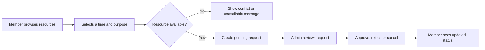
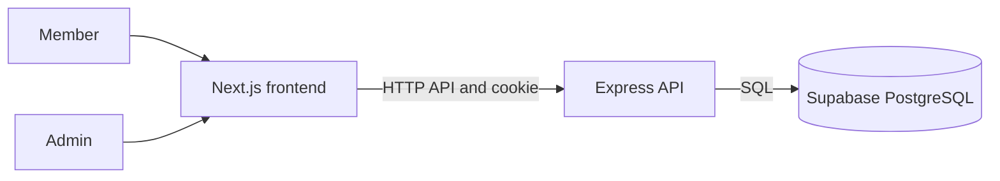

# ♻️ Roomly — Resource Reservation Management System

A full-stack workspace for discovering shared resources, requesting reservations, and managing organization-wide availability from one place.

> **The problem:** shared rooms and equipment are often coordinated through messages and spreadsheets. Roomly keeps resources, booking requests, teams, and availability in a single system.


## ✨ What you can do

### Team members
- Browse available rooms, workspaces, and equipment.
- Request a reservation for a time slot and see your booking status.
- Review your reservations and cancel pending requests.
- Join or leave teams and update your profile.

### Administrators
- Review usage and reservation activity from the admin dashboard.
- Add and edit resources and categories.
- Manage teams, member access, and organization reservations.
- Approve or reject pending reservations.
- Search and download tables as PDF.

### Reservation safeguards
- Reject invalid time ranges and bookings for unavailable resources.
- Prevent overlapping pending or approved reservations for the same resource.
- Serialize booking checks per resource to avoid simultaneous requests reserving the same slot.

## 🔄 How a reservation works



## 🧰 Technology

| Area | Stack |
| --- | --- |
| Frontend | Next.js 16, React, TypeScript, CSS Modules |
| API | Node.js, Express, TypeScript |
| Database | Supabase-hosted PostgreSQL |
| Auth | bcrypt password hashes and JWT in an HTTP-only cookie; admin sessions expire after 10 minutes; member sessions after 8 hours |
| UI and validation | Zod, React Hook Form, TanStack Query, Lucide |

The frontend uses the Next.js Pages Router for public, team member, and admin pages.

## 🏗️ Architecture



Supabase provides the managed PostgreSQL database. Authentication and role authorization are handled by the Express API; the app does not use Supabase Auth. SQL migrations define the schema.

## 📂 Project layout

```text
frontend/src/pages/          Next.js routes
frontend/src/components/     Admin, member, and shared UI
backend/src/routes/          API routes
backend/src/controllers/     HTTP request handling
backend/src/services/        Auth and business logic
backend/src/models/          PostgreSQL queries
backend/src/seeders/         Admin and member seeders
backend/migrations/          SQL migrations
docs/rrms-erd.drawio         ER diagram
```

## 🚀 Run locally

### Requirements
- Node.js 20.9 or later
- Supabase project with PostgreSQL database access
- npm

### Install and configure
From the repository root:

```sh
npm install
```

Copy `backend/.env.example` to `backend/.env`, and `frontend/.env.example` to `frontend/.env.local`. Set `DATABASE_URL` to the Supabase PostgreSQL Session Pooler connection string, `DATABASE_CA_CERT` to the downloaded Supabase root certificate path, a random `JWT_SECRET` of at least 32 characters, and the admin/member seed name, email, and password values in `backend/.env`. Use unique passwords of at least 12 characters. Never commit `backend/.env`.

For Supabase, set `DATABASE_CA_CERT` to the downloaded root certificate path as shown in `backend/.env.example`.

### Reservation approval emails

Set `COMPANY_MAIL_ADDRESS` and `COMPANY_MAIL_APP_PASSWORD` in `backend/.env` to the mailbox used by the application. The current mail transport uses Gmail SMTP, so the address must be the authenticated Gmail or Google Workspace mailbox, and the password must be an app password for that account (with 2-Step Verification enabled). Do not use the account's normal password or put credentials in source control.

The application sends one approval notification when an administrator changes a reservation from `pending` to `approved`. It goes to the active user accounts, including the requester; the configured sender mailbox also receives a copy. Creating, rejecting, or editing an already approved reservation does not send this notification.

Email styling and wording cannot determine inbox placement. If Gmail displays “Why is this message in spam? This message is similar to messages that were identified as spam in the past,” its spam classifier has likely learned from previous recipient reports or sender reputation. For an expected and legitimate message, a recipient can use **Report not spam** and add the sender address to contacts. Avoid sending unsolicited mail. For a custom domain, configure SPF and DKIM with the mail provider and publish a DMARC policy; make sure the visible From address aligns with the authenticated sending domain. Gmail/Workspace administrators can check authentication and reputation in Google Postmaster Tools when available.

### Initialize the database

```sh
npm run db:check --workspace backend
npm run db:migrate
npm run db:seed-admin
npm run db:seed-member
```

The admin seeder creates the initial admin plus sample team, categories, and resources. The member seeder creates a team-member account. Both use credentials from `backend/.env`; existing accounts and passwords are left unchanged.

### Start services
Run these in separate terminals from the repository root:

```sh
npm run dev:backend
```

```sh
npm run dev:frontend
```

Open [http://localhost:3000](http://localhost:3000). Sign in at [http://localhost:3000/login](http://localhost:3000/login). API health: [http://localhost:4000/api/health](http://localhost:4000/api/health).

## 🗃️ Data model

See the [ER diagram](docs/rrms-erd.drawio). Core tables are users, admins, teams, memberships, resource categories, resources, and reservations. Add schema changes as timestamped SQL files in `backend/migrations/`.

## Useful commands

- `npm run dev:frontend` — start Next.js
- `npm run dev:backend` — start Express
- `npm run build:frontend` — build frontend
- `npm run typecheck` — type-check both projects
- `npm run db:migrate` — apply migrations
- `npm run db:seed-admin` — seed admin and sample resources
- `npm run db:seed-member` — seed demo member

---
Built to make shared resource scheduling clear, reliable, and easy for teams.
